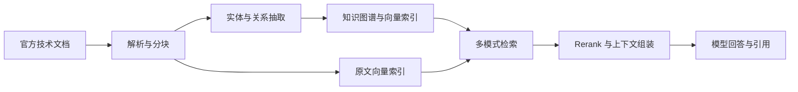

# LightRAG Engineering · 技术文档知识库问答系统

面向技术文档的知识库问答与检索工程实践，覆盖文档入库、图与向量检索、Rerank、引用溯源和评测。维护者：**孙家豪（[erli523](https://github.com/erli523)）**。

本项目基于 [HKUDS/LightRAG](https://github.com/HKUDS/LightRAG)，保留上游提交历史和 [MIT 许可证](LICENSE)。知识图谱抽取、多模式检索、WebUI 与存储框架来自上游；本仓库的工作集中在运行兼容性、评测接入，以及原文证据预算优化实验。

[工程说明](PROJECT_OVERVIEW_CN.md) · [已公开的个人改动](#已公开的个人改动) · [检索优化实验](#检索优化实验本地已验证代码尚未同步) · [本地运行](#本地运行) · [原版完整文档](README.upstream.md)

## 项目能做什么

- **文档入库**：上传文档或扫描目录，经过解析、分块、实体与关系抽取，写入文档状态、KV、向量和图存储。
- **多模式检索**：支持纯向量 `naive`、图增强 `local/global/hybrid`，以及结合图谱和原文向量的 `mix`；可接入 Rerank 重排候选。
- **问答与溯源**：通过 FastAPI 和 WebUI 查询知识库，返回回答、检索上下文及引用来源。
- **文档生命周期**：支持去重、更新、删除、取消、失败重试和中断恢复，保留状态记录供排查。
- **评测分析**：接入 RAGAS，分别检查检索证据、回答依据与相关性；本地扩展实验还记录来源覆盖、延迟、用量和失败样本。

以上为基于上游能力搭建和验证的系统链路，具体个人代码修改见下表。

## 已公开的个人改动

| 工作 | 解决的问题与实现 | 代码依据 |
|---|---|---|
| Windows 启动与状态接口 | 处理终端输出兼容性，修正文档 tracking 状态返回契约，并补充定向回归 | [启动与状态修复](https://github.com/erli523/lightrag-engineering/commit/d9ca2f455d0c8902f5bd2c5de3d91e788ca81637) |
| WebUI 测试可移植性 | 调整流式请求、凭据探测、页面恢复和图导入测试，减少对宿主环境的依赖并隔离测试状态 | [前端测试调整](https://github.com/erli523/lightrag-engineering/commit/3f9cb2c46b67d3a34d631a210d56aaa09dae5c1a) |
| RAGAS 多服务商接入 | 支持评测 LLM 与 Embedding 的独立 OpenAI-compatible 端点；调整 Embedding 请求选项并补充测试 | [评测兼容改动](https://github.com/erli523/lightrag-engineering/commit/23ca7716fd5e156d4407e6e14fc877f181e74438) |

既有工程验收记录包含：五种检索模式、带引用的 mix 回答，以及扫描、去重、删除、取消、重试和硬重启恢复样本。前端记录为 613 项测试通过，Python 定向回归为 6 项通过；这些是此前验收记录，包含原有测试，不表示全部由本人新增，也不表示本次重新运行了全套测试。详见[工程实践说明](PROJECT_OVERVIEW_CN.md)。

## 检索优化实验：本地已验证，代码尚未同步

> **发布状态（2026-10-23）**：下述证据预算修改、独立评测工具及其新增测试目前仍在本地工作区，尚未包含在公开 `engineering` 分支中。这里记录实验工作和结果；直接克隆当前公开分支不能使用 `chunk_token_reserve`。上表中的三个改动已公开，可通过提交链接检查。

### 发现的问题

在固定总上下文预算下，`mix` 已召回原文候选，但实体和关系描述可能先占满上下文，导致最终提供给模型的原文片段为空。增加向量召回数量无法直接解决这种预算分配问题。

### 完成的修改

1. 增加可配置的原文 token 预留参数 `chunk_token_reserve`，在同一总预算内为原文证据留出空间；默认值为 0，保持原有行为。
2. 联合裁剪实体与关系上下文，保留各自原排序，不修改输入对象；覆盖极小预算等边界条件。
3. 打通 SDK、API 与 `aquery_data` 内部参数复制，返回预算元数据供定位问题。
4. 将非默认预算配置纳入回答缓存标识，避免不同配置串用答案，同时保持默认缓存键兼容。
5. 搭建带 URL、内容哈希和来源标签的评测流程，支持断点续跑、失败样本留存和用量记录。

这里的改进是上下文分配和工程一致性处理，未重新实现上游的图谱抽取、向量检索或 Rerank。

### 已有结果与适用范围

实验使用 **12 篇 LangChain/LangGraph 官方文档**，形成 88 个文本块、993 个实体和 1,659 条关系。18 道来源标注问题包含 8 道单文档、6 道跨文档、4 道无答案题；开发集与留出集各 9 道，其中各有 7 道可回答题。

固定总预算为 **6,000 tokens**，图检索 `top_k=10`、原文 `chunk_top_k=5`；改前原文预留为 0，改后为 3,000。以下指标来自 **7 道留出可回答题**，配置在查看留出结果前冻结。

| 检索配置 | 改前文档级原文 Recall@5 | 改后文档级原文 Recall@5 |
|---|---:|---:|
| 纯向量 naive | 100.0% | 100.0% |
| 纯向量 naive + Rerank | 100.0% | 100.0% |
| mix | 28.6% | 92.9% |
| **mix + Rerank** | **28.6%** | **85.7%** |

- **改动对应的结果**：mix + Rerank 最终上下文不含原文片段的情况由 5/7 降至 0/7；相关模块共 **74 项回归测试通过**，包含已有测试及新增/修改测试。
- **指标定义**：每题最终最多 5 个原文片段所覆盖的预期来源文档数，除以该题所需来源文档数，再对可回答题取平均。同一文档的重复片段不重复计分；无答案题不进入 Recall 分母。它不等于回答准确率。
- **保留的负面结果**：改后仍有两道跨文档题未覆盖全部来源；同一数据集纯向量召回更高，不能据此声称图增强整体更优。mix + Rerank 平均检索耗时由 5.95 秒变为 6.97 秒，没有延迟提升结论。
- **实验边界**：这是小型工程对照，未证明生产效果或统计显著性。全量测试未完成，74 项仅为定向回归范围。160 篇语料与千题扩展实验尚未完成，不作为已有完整评测结果。

## 技术栈与链路

| 层次 | 本次使用与验证 |
|---|---|
| 后端与服务 | Python 3.10+、asyncio、FastAPI、REST / 流式响应 |
| RAG | LightRAG、多模式检索、图与向量混合召回、Rerank、引用溯源 |
| 本地存储 | JsonKVStorage、JsonDocStatusStorage、NetworkX、NanoVectorDB |
| 界面 | 上游 React / TypeScript / Vite / Bun WebUI |
| 验证工具 | pytest、Bun test、RAGAS；本地另有检索对照和用量记录工具 |

本地验收使用 JSON / NetworkX / NanoVectorDB 组合。PostgreSQL、Neo4j、Milvus 等属于上游可选后端，不作为本项目已启用或压测的配置。



证据预算实验修改的是上下文组装阶段，以及对应的参数传递、预算记录和缓存行为。

## 本地运行

以下以 Windows PowerShell 为例，需要 Git、Python 3.10+、uv；构建 WebUI 还需要 Bun。运行配置以 [env.example](env.example) 为准。

```powershell
git clone --branch engineering https://github.com/erli523/lightrag-engineering.git
cd lightrag-engineering
uv sync --extra api

# 仅在没有配置文件时创建；随后编辑本地 .env。
if (-not (Test-Path .env)) { Copy-Item env.example .env }
```

启动前在 `.env` 中配置 LLM、Embedding 和所需的 Rerank 服务，确认 Embedding 维度与提供商模型一致。本地试用可设置 `HOST=127.0.0.1`、`PORT=9621`。密钥只保存在本地，不提交到仓库；实际入库、问答和 RAGAS 评测可能产生模型调用费用。

```powershell
cd lightrag_webui
bun install --frozen-lockfile
bun run build
cd ..
uv run lightrag-server
```

使用上述端口时，打开 [WebUI](http://127.0.0.1:9621/webui/) 或 [API 文档](http://127.0.0.1:9621/docs)。上传文档，等待入库完成，再通过 `naive` / `mix` 等模式检查回答和来源引用。更换 Embedding 模型时使用独立知识库目录，避免与原有向量混用。

### 评测入口

公开分支的 RAGAS 入口为 [eval_rag_quality.py](lightrag/evaluation/eval_rag_quality.py)，使用方法见 [RAGAS 评测文档](lightrag/evaluation/README_EVALUASTION_RAGAS.md)。评测 LLM 与 Embedding 可分别配置 `EVAL_LLM_BINDING_HOST`、`EVAL_EMBEDDING_BINDING_HOST` 及对应密钥。

本地的 12 篇文档检索实验和千题扩展工具尚未发布，不能用上述 RAGAS 入口复现表中的预算对照数字。当前仓库不附带私有配置、模型密钥或本地运行存储。

## 文档导航与来源

- [工程实践说明](PROJECT_OVERVIEW_CN.md)：此前搭建、改动、运行验收和边界。
- [原版完整 README](README.upstream.md)：保留此次改写前的完整文档，含上游配置与功能介绍；其中上游基准、版本新闻与能力声明不代表本项目独立成果。
- [中文上游使用说明](README-zh.md)、[API 服务说明](docs/LightRAG-API-Server.md)、[SDK 编程说明](docs/ProgramingWithCore.md)。
- 上游：[HKUDS/LightRAG](https://github.com/HKUDS/LightRAG)；论文：[LightRAG: Simple and Fast Retrieval-Augmented Generation](https://arxiv.org/abs/2410.05779)。
- 许可证：[MIT License](LICENSE)，保留 LightRAG Team 版权声明。
